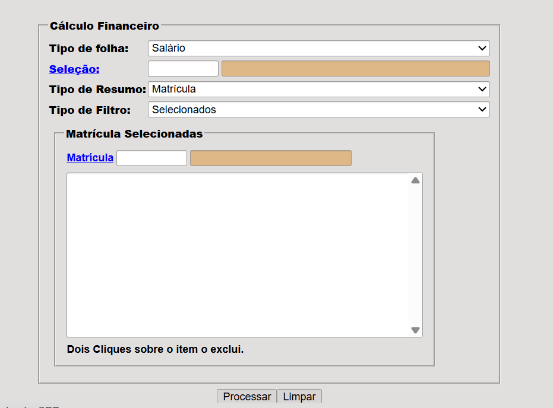
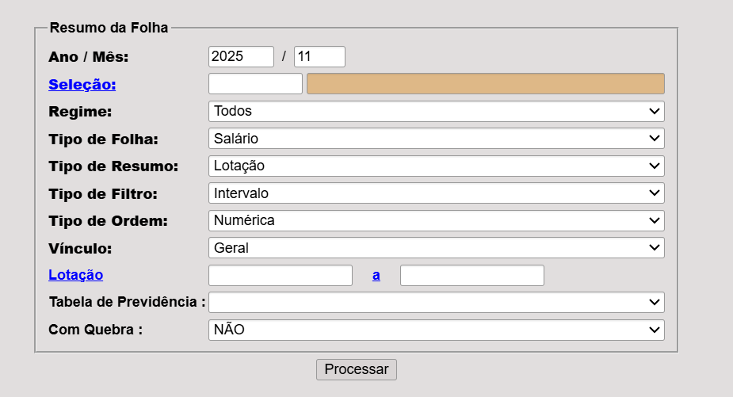
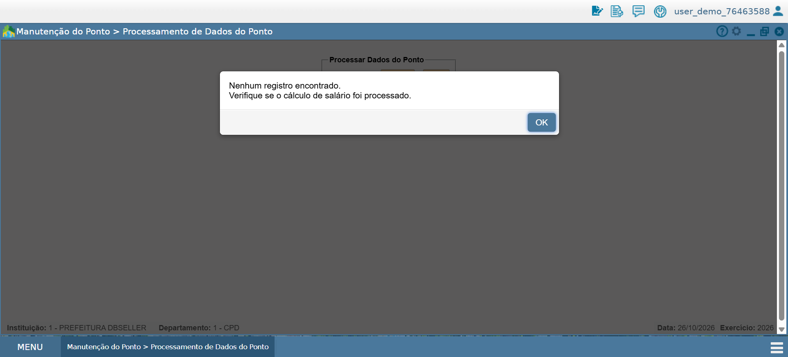
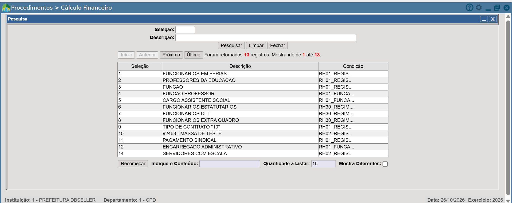
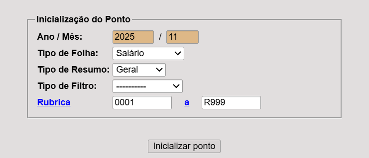
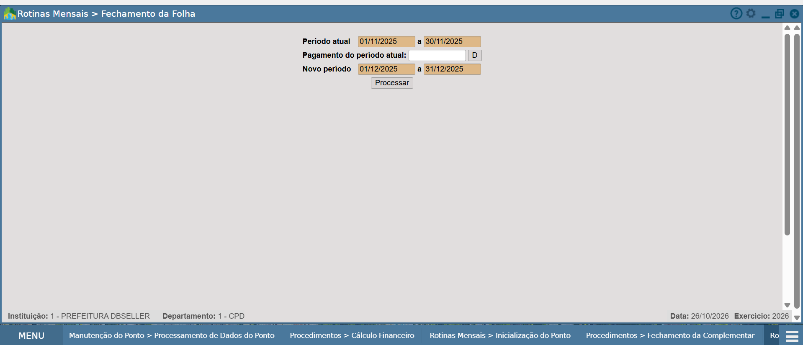

# 1. Jornada e Tarefa

## 1.1. Contextualização do e-Cidade e da área de RH

O e-Cidade é um sistema integrado de gestão pública municipal, desenvolvido e mantido pela DBSeller, utilizado por servidores públicos para executar atividades administrativas. O sistema possui uma arquitetura monolítica e abrange sete grandes áreas, incluindo Recursos Humanos (RH).

No projeto de modernização do e-Cidade, nosso grupo escolheu a área de **Recursos Humanos**, com foco em dois processos: **Folha de Pagamento e Rubrica**, mapeados por meio de diagramas BPMN AS-IS e TO-BE.

Durante as atividades, foram consideradas três perspectivas de análise:

- **Prefeitura:** organização responsável pela gestão administrativa e pelos resultados dos processos executados no e-Cidade.
- **DBSeller:** empresa responsável pelo desenvolvimento e manutenção do sistema.
- **Servidor público:** usuário que interage diretamente com o e-Cidade para realizar suas atividades operacionais.

Nesta ponderada individual, adota-se a **perspectiva da Prefeitura**. A avaliação considera a experiência do servidor nas telas e sua relação com a execução da rotina administrativa, buscando identificar dificuldades de usabilidade e possíveis fronteiras para a extração de microsserviços do monólito.

## 1.2. Jornada escolhida

A jornada selecionada é **preparar, calcular e conferir a folha de pagamento mensal**, pertencente à área de Recursos Humanos do e-Cidade.

O BPMN AS-IS elaborado pelo grupo representa o processo atual e orienta a construção do Service Blueprint individual. Suas etapas são detalhadas na seção 1.3.

*Figura 1 — BPMN AS-IS da jornada de folha de pagamento. Fonte: elaborado pelo grupo (2026).*

## 1.3. Usuário e tarefa

**Quem:** servidor público municipal do setor de Pessoal ou Recursos Humanos, responsável pelas rotinas mensais da folha de pagamento.

**O que faz:** prepara o movimento mensal, realiza o cálculo da folha de pagamento e confere os resultados no e-Cidade.

**Para quê:** garantir que a folha esteja correta e confiável para a continuidade das atividades administrativas da prefeitura, reduzindo riscos de atrasos e retrabalho.

**Etapas da jornada, conforme o BPMN AS-IS:**

1. Preparar o movimento mensal, incluindo o ponto e os lançamentos necessários.
2. Executar o cálculo do ponto fixo.
3. Selecionar a abrangência do cálculo salarial.
4. Processar o cálculo da folha de pagamento.
5. Emitir os relatórios de conferência.
6. Conferir os resultados da folha.

O BPMN representa o processo de referência. Na navegação pelo ambiente de demonstração, foram identificadas funcionalidades relacionadas a essas atividades, embora não tenha sido possível confirmar a correspondência de todas as etapas com telas específicas.

## 1.4. Telas e módulos envolvidos

A navegação foi realizada no ambiente de demonstração do e-Cidade, utilizando a instituição **1 - PREFEITURA DBSELLER**, a área **DB:RECURSOSHUMANOS** e o módulo **Pessoal**.

A Figura 2 apresenta o menu de acesso ao módulo Pessoal, utilizado como ponto de entrada para as funcionalidades analisadas.

*Figura 2 — Acesso ao módulo Pessoal na área de Recursos Humanos. Fonte: captura do ambiente de demonstração do e-Cidade (2026).*

As funcionalidades localizadas durante a navegação foram relacionadas às atividades da jornada:

| Atividade da jornada | Funcionalidade / caminho no e-Cidade | Módulo |
|---|---|---|
| Preparação do movimento mensal | Procedimentos → Rotinas Mensais → Inicialização do Ponto | Pessoal |
| Preparação e processamento dos dados do ponto | Procedimentos → Manutenção do Ponto → Processamento de Dados do Ponto | Pessoal |
| Cálculo do ponto fixo | Funcionalidade específica não identificada nas telas analisadas | Não confirmado |
| Configuração e cálculo financeiro | Procedimentos → Cálculo Financeiro | Pessoal |
| Fechamento da folha (funcionalidade relacionada) | Procedimentos → Rotinas Mensais → Fechamento da Folha | Pessoal |
| Emissão de relatórios de conferência | Relatórios → Relatórios Financeiros → Resumo da Folha | Pessoal |
| Consulta de relatórios para conferência | Relatórios → Relatórios Financeiros → Folha Analítica / Sintética | Pessoal |

A Figura 3 apresenta a tela de Cálculo Financeiro, na qual foram observados campos de configuração, incluindo Tipo de Folha, Seleção, Tipo de Resumo e Tipo de Filtro. Entre as opções de Tipo de Resumo estão Geral, Matrícula e Lotação, mas não foi confirmado se elas determinam a abrangência do processamento ou apenas a apresentação dos resultados.

*Figura 3 — Tela de Cálculo Financeiro. Fonte: captura do ambiente de demonstração do e-Cidade (2026).*

A Figura 4 apresenta a interface de Resumo da Folha, utilizada para configurar um dos relatórios relacionados à conferência dos resultados.

*Figura 4 — Tela de configuração do Resumo da Folha. Fonte: captura do ambiente de demonstração do e-Cidade (2026).*

As telas comprovam o acesso às funcionalidades no ambiente de demonstração. Entretanto, **não foi validada a execução completa do cálculo salarial nem a geração dos resultados dos relatórios**.

Todas as funcionalidades identificadas nesta navegação pertencem ao módulo Pessoal. Possíveis dependências com outros módulos serão consideradas no Service Blueprint AS-IS somente quando houver evidências que as sustentem.

## 1.5. Delimitação da jornada

Os limites da jornada avaliada são apresentados a seguir.

| Limite | Definição |
|---|---|
| **Início** | O servidor do setor de Pessoal inicia a preparação do movimento mensal, incluindo a inicialização do ponto e a organização dos lançamentos necessários ao cálculo. |
| **Fim** | O servidor realiza a conferência dos resultados da folha após o processamento e a emissão dos relatórios previstos no processo. |

**Atividades fora do escopo:**

- **Pagamentos bancários:** transferências e procedimentos financeiros posteriores à conferência da folha.
- **Gestão cadastral:** admissões, desligamentos e alterações cadastrais que não integram diretamente a jornada.
- **Processo de Rubrica:** cadastro e manutenção de rubricas, analisados separadamente pelo grupo.
- **Outros processos do e-Cidade:** funcionalidades que não participam diretamente da jornada selecionada.

O fechamento da folha foi identificado durante a navegação como uma funcionalidade relacionada ao processo, mas sua posição na sequência principal deverá ser confirmada com o BPMN AS-IS.

# 2. Avaliação Heurística

## 2.1. Metodologia da avaliação heurística

A avaliação heurística foi realizada individualmente, em 26 de outubro de 2026, no ambiente de demonstração do e-Cidade, considerando a jornada de preparação, cálculo e conferência da folha de pagamento.

A análise adotou a perspectiva institucional da Prefeitura, observando a experiência do servidor público municipal durante a utilização do módulo Pessoal, na área de Recursos Humanos.

Foram examinadas as interfaces de inicialização do ponto, processamento de dados do ponto, cálculo financeiro, pesquisa de seleções e configuração dos relatórios de conferência.

A identificação dos problemas seguiu as dez heurísticas de usabilidade de Jakob Nielsen:

1. **Visibilidade do status do sistema:** informar ao usuário o que está acontecendo.
2. **Correspondência entre o sistema e o mundo real:** utilizar linguagem familiar ao usuário.
3. **Controle e liberdade do usuário:** permitir cancelar, voltar ou desfazer ações.
4. **Consistência e padrões:** manter comportamentos e elementos padronizados.
5. **Prevenção de erros:** evitar ações equivocadas antes que aconteçam.
6. **Reconhecimento em vez de memorização:** reduzir a necessidade de memorizar informações.
7. **Flexibilidade e eficiência de uso:** facilitar a execução das tarefas.
8. **Estética e design minimalista:** apresentar informações relevantes sem excesso de elementos.
9. **Reconhecimento, diagnóstico e recuperação de erros:** apresentar mensagens claras e orientar a solução.
10. **Ajuda e documentação:** oferecer orientações quando necessário.

Cada problema recebeu um identificador, a indicação da heurística violada, uma evidência visual e uma classificação de severidade.

A avaliação foi limitada às telas e interações observadas. Não foram realizados testes com servidores públicos reais, nem validada a execução completa do cálculo salarial ou a geração dos relatórios finais.

## 2.2. Escala de severidade

A severidade dos problemas foi classificada de 0 a 4, considerando frequência, impacto na execução da tarefa e persistência do problema.

| Severidade | Classificação | Descrição |
|---|---|---|
| **0** | Não é problema | A situação não representa uma dificuldade de usabilidade. |
| **1** | Cosmético | Problema de baixo impacto, cuja correção não é prioritária. |
| **2** | Menor | Dificuldade que pode prejudicar a interação, mas geralmente permite continuar a tarefa. |
| **3** | Maior | Problema significativo que pode comprometer a execução da tarefa ou gerar retrabalho. |
| **4** | Catastrófico | Problema crítico que pode impedir a conclusão da tarefa ou provocar consequências graves. |

As classificações representam estimativas da avaliação heurística, não resultados de testes com usuários.

## 2.3. Problemas de usabilidade identificados

A tabela apresenta os principais problemas observados nas telas da jornada de folha de pagamento.

| ID | Tela / elemento | Heurística violada | Problema identificado | Severidade |
|---|---|---|---|---|
| **H-01** | Processamento de Dados do Ponto — mensagem de retorno | H9 — Recuperação de erros | A mensagem informa que nenhum registro foi encontrado e orienta verificar o cálculo salarial, mas não apresenta um caminho direto para realizar essa verificação. | **2 — Menor** |
| **H-02** | Cálculo Financeiro — campos de seleção e filtro | H6 — Reconhecimento em vez de memorização | A interface utiliza campos como Seleção e Tipo de Filtro sem orientações visíveis suficientes para explicar sua utilização. | **2 — Menor** |
| **H-03** | Pesquisa de Seleção — coluna Condição | H2 — Correspondência com o mundo real | A coluna apresenta expressões técnicas e informações truncadas, dificultando a compreensão dos critérios das seleções cadastradas. | **2 — Menor** |
| **H-04** | Inicialização do Ponto — botão de inicialização | H5 — Prevenção de erros | A tela não apresenta, antes do acionamento, uma explicação visível sobre os dados que serão afetados pela inicialização do ponto. | **3 — Maior** |
| **H-05** | Fechamento da Folha — botão “D” | H6 — Reconhecimento em vez de memorização | O botão identificado apenas pela letra “D” não possui uma explicação visível sobre sua finalidade. | **1 — Cosmético** |
| **H-06** | Resumo da Folha — filtros de configuração | H10 — Ajuda e documentação | A tela apresenta vários filtros sem orientações visíveis que expliquem seu preenchimento e quais campos são necessários para gerar o relatório. | **2 — Menor** |

## 2.4. Evidências visuais e justificativas

### H-01 — Mensagem de retorno sem orientação suficiente

**Tela:** Processamento de Dados do Ponto.

**Elemento:** mensagem apresentada após a tentativa de processamento.

*Figura 5 — Mensagem apresentada no Processamento de Dados do Ponto. Fonte: captura do ambiente de demonstração do e-Cidade (2026).*

**Descrição:** o sistema informa que nenhum registro foi encontrado e solicita que o servidor verifique se o cálculo salarial foi processado. Entretanto, a mensagem não indica onde essa verificação deve ser realizada.

**Heurística violada:** H9 — Ajudar o usuário a reconhecer, diagnosticar e recuperar erros.

**Severidade: 2 — Menor.**

**Justificativa:** a dificuldade pode ocorrer quando não existem registros disponíveis para a competência selecionada. O impacto está na necessidade de procurar manualmente a rotina relacionada ao cálculo salarial. O problema permanece enquanto a mensagem não oferecer uma orientação mais específica, embora o servidor possa continuar a navegação.

### H-02 — Falta de orientação nos campos do cálculo financeiro

**Tela:** Cálculo Financeiro.

**Elementos:** Seleção, Tipo de Filtro e Matrícula.

*Figura 6 — Campos de configuração do Cálculo Financeiro. Fonte: captura do ambiente de demonstração do e-Cidade (2026).*

**Descrição:** a tela apresenta diferentes campos de configuração, mas não explica claramente a finalidade de cada opção ou como elas se relacionam. O servidor precisa compreender previamente o significado das seleções para configurar o cálculo.

**Heurística violada:** H6 — Reconhecimento em vez de memorização.

**Severidade: 2 — Menor.**

**Justificativa:** a dificuldade pode surgir sempre que o servidor precisa configurar um cálculo sem conhecer os critérios utilizados pelo sistema. O impacto potencial é a seleção inadequada de filtros ou a necessidade de consultar orientações externas. A limitação permanece na interface, mas a tarefa pode ser realizada por usuários familiarizados com os campos.

### H-03 — Linguagem técnica na pesquisa de seleções

**Tela:** Pesquisa de Seleção.

**Elemento:** coluna Condição.

*Figura 7 — Janela de pesquisa de seleções no Cálculo Financeiro. Fonte: captura do ambiente de demonstração do e-Cidade (2026).*

**Descrição:** a pesquisa apresenta condições com expressões técnicas e partes do conteúdo truncadas. Isso dificulta compreender os critérios utilizados para formar determinados grupos de servidores.

**Heurística violada:** H2 — Correspondência entre o sistema e o mundo real.

**Severidade: 2 — Menor.**

**Justificativa:** a dificuldade é reproduzível quando o usuário consulta condições cujo conteúdo não aparece integralmente. O impacto está na interpretação dos critérios de seleção, exigindo conhecimento técnico adicional. Embora as descrições dos grupos ajudem na identificação, elas não esclarecem completamente as condições apresentadas.

### H-04 — Ausência de orientação prévia sobre a inicialização do ponto

**Tela:** Inicialização do Ponto.

**Elemento:** botão Inicializar Ponto.

*Figura 8 — Tela de Inicialização do Ponto. Fonte: captura do ambiente de demonstração do e-Cidade (2026).*

**Descrição:** a interface permite solicitar a inicialização do ponto sem apresentar previamente uma explicação visível sobre quais registros serão afetados. O BPMN AS-IS do grupo também identifica riscos associados à reinicialização de lançamentos variáveis.

**Heurística violada:** H5 — Prevenção de erros.

**Severidade: 3 — Maior.**

**Justificativa:** caso a operação afete lançamentos existentes, uma inicialização equivocada pode provocar retrabalho e comprometer a preparação da folha. O impacto potencial é elevado devido à natureza da atividade. A classificação considera esse risco documentado no processo, mas não foi verificado se o sistema apresenta uma confirmação adicional depois do clique.

### H-05 — Botão com identificação pouco clara

**Tela:** Fechamento da Folha.

**Elemento:** botão identificado pela letra “D”, próximo ao campo de pagamento do período atual.

*Figura 9 — Tela de Fechamento da Folha. Fonte: captura do ambiente de demonstração do e-Cidade (2026).*

**Descrição:** o botão apresenta apenas a letra “D”, sem descrição visível sobre sua função. Isso exige que o servidor conheça previamente o significado do elemento.

**Heurística violada:** H6 — Reconhecimento em vez de memorização.

**Severidade: 1 — Cosmético.**

**Justificativa:** a falta de identificação dificulta a compreensão inicial, mas não foi observado impedimento direto à realização da tarefa. O problema é persistente na apresentação do controle, porém seu impacto não foi comprovado como significativo.

### H-06 — Ausência de orientação sobre filtros do relatório

**Tela:** Resumo da Folha.

**Elementos:** filtros de configuração do relatório.

*Figura 10 — Campos de configuração do Resumo da Folha. Fonte: captura do ambiente de demonstração do e-Cidade (2026).*

**Descrição:** a interface apresenta diferentes campos, como Regime, Vínculo, Tipo de Resumo, Tipo de Filtro, Lotação e Tabela de Previdência, sem instruções visíveis sobre quais devem ser preenchidos ou como suas combinações influenciam o relatório.

**Heurística violada:** H10 — Ajuda e documentação.

**Severidade: 2 — Menor.**

**Justificativa:** a dificuldade pode ocorrer durante a configuração dos relatórios, principalmente quando o servidor precisa utilizar combinações de filtros pouco familiares. O impacto potencial é o aumento do tempo necessário para configurar a consulta. A dificuldade permanece na ausência de orientação contextual, mas não foi comprovado que impeça a emissão do relatório.

## 2.5. Síntese da avaliação heurística

A análise identificou dificuldades principalmente relacionadas à clareza das informações, à orientação durante a configuração das funcionalidades e à prevenção de erros em operações administrativas.

Os problemas H-01, H-02, H-03 e H-06 estão associados à compreensão e à execução das tarefas. O H-04 merece atenção especial devido ao risco potencial de retrabalho na preparação da folha, enquanto o H-05 representa uma dificuldade de interpretação de um elemento da interface.

Esses achados serão relacionados às etapas correspondentes no Service Blueprint AS-IS, permitindo visualizar onde as dificuldades ocorrem durante a jornada e avaliar sua relação com as responsabilidades do sistema.

A avaliação não comprova, isoladamente, que os problemas decorrem da arquitetura monolítica. Essa relação deverá ser investigada na análise dos processos de suporte e das dependências técnicas.

# 3. Service Blueprint AS-IS

## 3.1. Descrição da jornada atual com base no BPMN AS-IS

[PENDENTE DE VALIDAÇÃO] Disponibilizar o BPMN AS-IS do grupo em `../assets/bpmn/`, registrar autoria, versão e data, e referenciá-lo por caminho relativo. Descrever a sequência real de atividades, decisões e responsáveis. O BPMN ainda não consta no repositório.

## 3.2. Ações do servidor, frontstage e backstage

[PENDENTE DE VALIDAÇÃO] Preencher o quadro a partir do BPMN e das evidências da jornada, distinguindo as ações do servidor, as interações visíveis e as operações internas verificadas.

| Etapa do BPMN | Ações do servidor | Frontstage | Backstage | Evidência |
| --- | --- | --- | --- | --- |

## 3.3. Processos de suporte e módulos do monólito

[PENDENTE DE VALIDAÇÃO] Identificar os processos de suporte e os módulos efetivamente envolvidos, com suas responsabilidades e fontes de comprovação. A arquitetura e os nomes dos módulos ainda não foram verificados.

## 3.4. Cruzamentos entre módulos

[PENDENTE DE VALIDAÇÃO] Registrar somente cruzamentos sustentados por documentação ou observação, indicando a etapa, os módulos de origem e destino, os dados ou controles envolvidos e a evidência correspondente.

| Etapa | Módulo de origem | Módulo de destino | Dados ou controles envolvidos | Evidência |
| --- | --- | --- | --- | --- |

## 3.5. Pontos de falha e rastreabilidade heurística

Os pontos de falha deverão receber identificadores estáveis no formato `PF-01`. Cada registro deverá referenciar os problemas `H-XX` da seção 2.3; a tabela heurística deverá apontar de volta para os respectivos pontos `PF-XX`. Os identificadores serão atribuídos quando houver evidência, sem renumerar registros já utilizados.

[PENDENTE DE VALIDAÇÃO] Não há pontos de falha comprovados nesta versão.

| ID do ponto de falha | Etapa do blueprint | Falha observada | Problemas heurísticos relacionados | Evidência |
| --- | --- | --- | --- | --- |

## 3.6. Imagem do blueprint elaborado no Miro ou FigJam

[PENDENTE DE VALIDAÇÃO] Elaborar e validar o blueprint no Miro ou FigJam, exportar sua imagem para `../assets/blueprint/` e inseri-la aqui por caminho relativo, com legenda, autoria, versão e data. O artefato deverá explicitar as camadas descritas e os identificadores de falha da seção 3.5. Nenhuma imagem foi fornecida.

# 4. Proposta de Extração do Primeiro Microsserviço

## 4.1. Microsserviço proposto e justificativa

[PENDENTE DE VALIDAÇÃO] Definir o serviço candidato após a avaliação heurística e o blueprint, citando os problemas `H-XX` e os pontos de falha `PF-XX` que sustentam a proposta. Não há evidências suficientes para selecionar um microsserviço nesta versão.

## 4.2. Responsabilidades, limites e benefícios para a prefeitura

[PENDENTE DE VALIDAÇÃO] Delimitar responsabilidades, dados, interfaces e dependências do candidato. Explicitar os benefícios esperados para a prefeitura e como poderão ser avaliados, distinguindo hipóteses de resultados comprovados.

## 4.3. Critério técnico contrário à extração e problemas não resolvidos

[PENDENTE DE VALIDAÇÃO] Apresentar um critério técnico que contraindique a extração com base na arquitetura verificada. Identificar os problemas heurísticos que permaneceriam após a extração e justificar essa limitação.

**Limite da entrega final:** toda a seção 4, incluindo seus subtítulos, deverá ocupar no máximo uma página. Verificar esse limite na diagramação da futura entrega.

# 5. Declaração de Uso de IA

## 5.1. Ferramentas utilizadas e contribuições

O Codex foi utilizado para inspecionar a estrutura do repositório, organizar este documento único, atualizar o README e criar as pastas destinadas às evidências e à entrega. A assistência incluiu a estruturação textual e a identificação explícita das lacunas de informação.

[PENDENTE DE VALIDAÇÃO] Complementar a declaração caso outras ferramentas de IA sejam utilizadas, indicando suas contribuições efetivas.

## 5.2. Limites da utilização e responsabilidade pela análise

A IA não realizou avaliação de telas, validação do BPMN, inspeção da arquitetura ou consulta às referências técnicas e acadêmicas nesta etapa. Não foram produzidos prints, problemas heurísticos, cruzamentos de módulos ou conclusões técnicas. A validação das evidências, a análise crítica e a responsabilidade pelo conteúdo final cabem aos autores da atividade.

# 6. Referências

## 6.1. Referências acadêmicas e técnicas efetivamente consultadas

[PENDENTE DE VALIDAÇÃO] Nenhuma referência acadêmica ou técnica foi disponibilizada ou consultada nesta etapa de organização. Incluir apenas obras efetivamente consultadas, com dados bibliográficos, endereço quando aplicável e data de acesso.

## 6.2. Documentação do e-Cidade

[PENDENTE DE VALIDAÇÃO] Registrar os documentos efetivamente consultados, com título, responsável, versão, endereço e data de acesso.

## 6.3. Materiais da professora

[PENDENTE DE VALIDAÇÃO] Registrar os materiais efetivamente consultados, incluindo o enunciado e o barema, com autoria, título e data ou versão. Esses materiais ainda não constam no repositório.

## 6.4. BPMN AS-IS do grupo

[PENDENTE DE VALIDAÇÃO] Registrar o título, a autoria, a versão e a data do BPMN utilizado, com caminho relativo para o artefato em `../assets/bpmn/`.

## 6.5. TAPI da DBSeller

[PENDENTE DE VALIDAÇÃO] Identificar o material da TAPI da DBSeller efetivamente consultado, com título, versão, endereço e data de acesso. Nenhuma informação técnica foi inferida desse material nesta versão.
