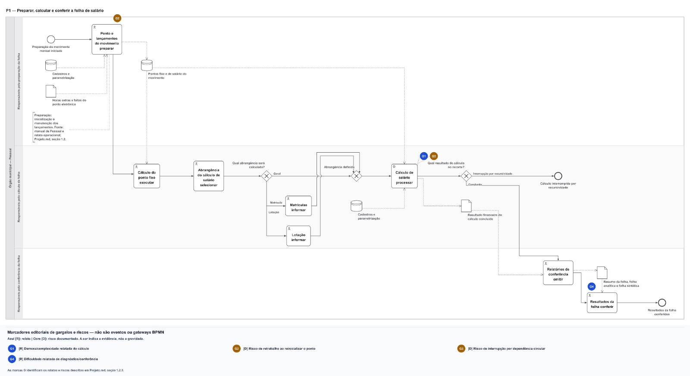
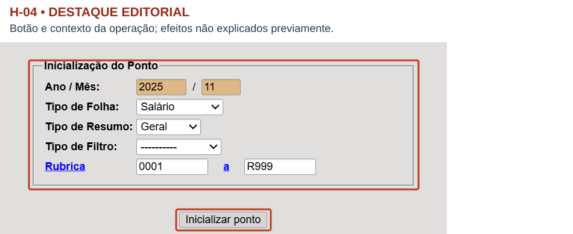
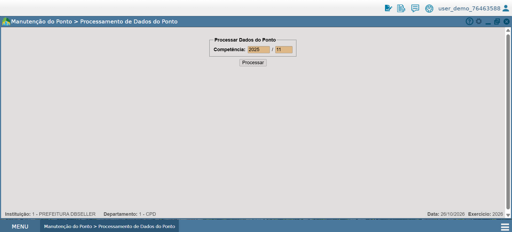
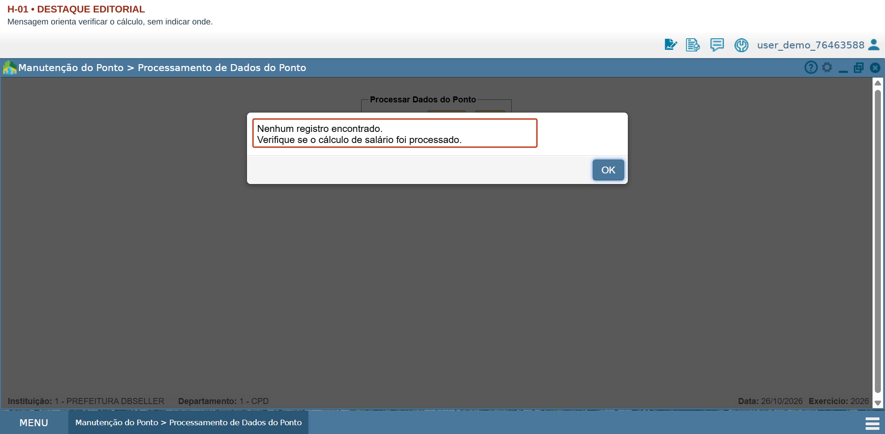
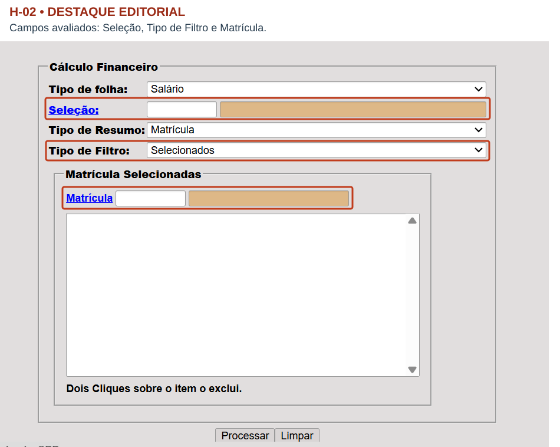
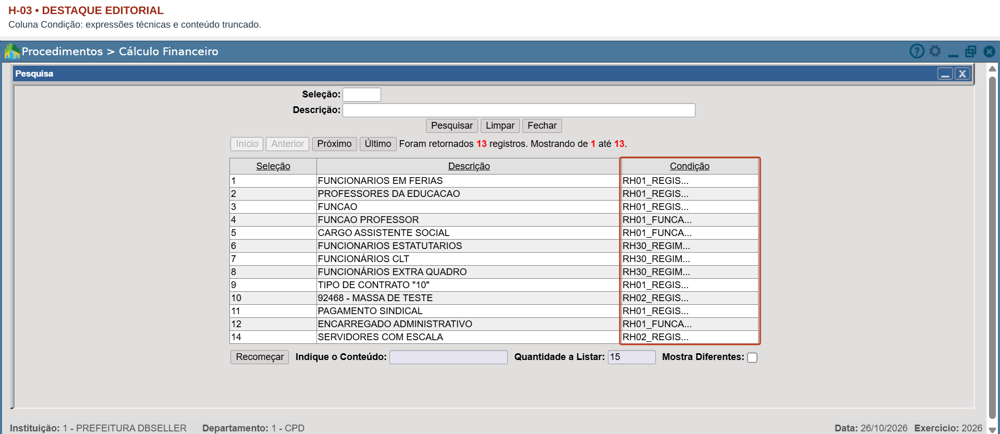
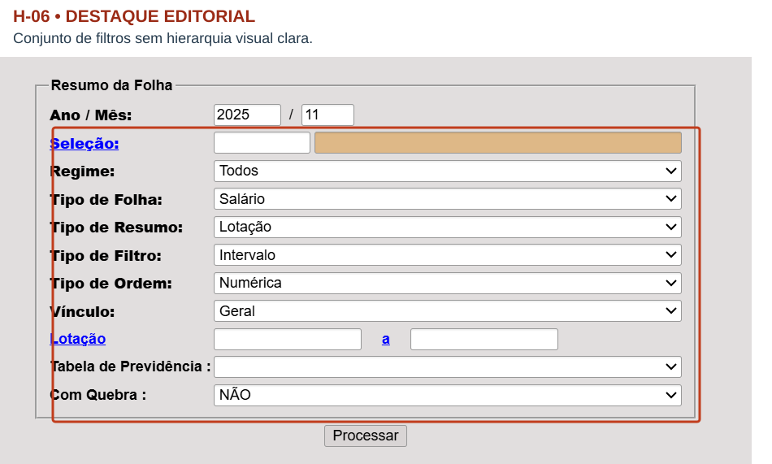
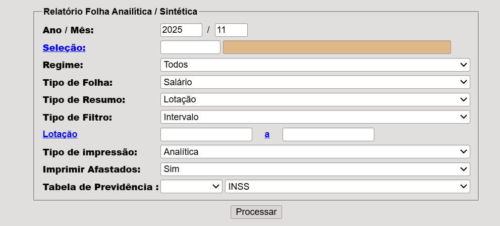
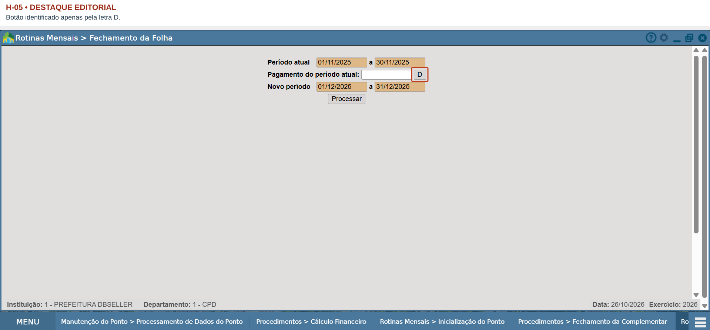
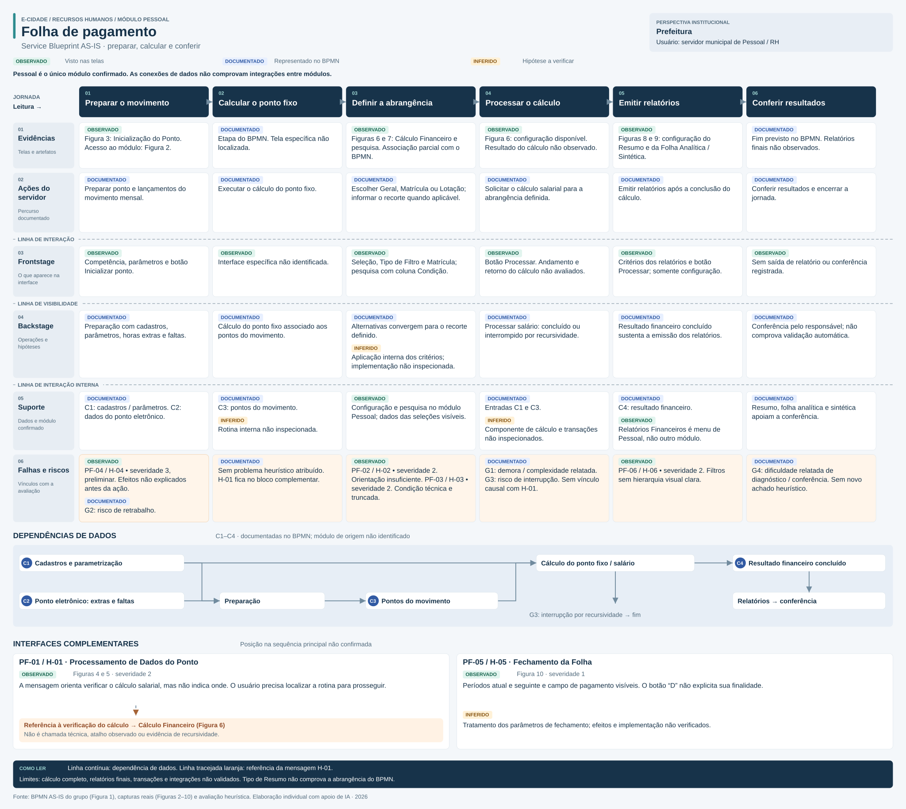

<link rel="stylesheet" href="../assets/styles/entrega.css">

# 1. Jornada e Tarefa

## 1.1. Contextualização do e-Cidade e da área de RH

O e-Cidade é um sistema integrado de gestão pública municipal, desenvolvido e mantido pela DBSeller, utilizado por servidores públicos na execução de atividades administrativas. Sua estrutura monolítica abrange sete grandes áreas, entre elas Recursos Humanos (RH).

No projeto de modernização, o grupo trabalhou os processos de Folha de Pagamento e Rubrica, mapeados em BPMN AS-IS e TO-BE. Esta ponderada individual concentra-se na Folha de Pagamento: a Prefeitura é a perspectiva institucional da análise, e o servidor municipal de Pessoal/RH é o usuário que interage com as interfaces. A avaliação busca relacionar sua experiência à execução da rotina e à investigação de uma possível fronteira de extração do monólito.

## 1.2. Jornada escolhida

Durante a atividade proposta pela professora, foi escolhida individualmente a jornada de **Folha de Pagamento, na perspectiva da Prefeitura**, entre os fluxos das áreas trabalhadas pelos grupos. O recorte adotado é **preparar, calcular e conferir a folha de pagamento mensal**.

O BPMN AS-IS do grupo (Figura 1) orienta a avaliação heurística, o Service Blueprint individual e a proposta de extração.

*Figura 1 — BPMN AS-IS da jornada de folha de pagamento. Fonte: elaborado pelo grupo (2026). Original preservado; página horizontal própria na exportação.*

## 1.3. Usuário e tarefa

**Quem:** servidor público municipal do setor de Pessoal ou Recursos Humanos, responsável pelas rotinas mensais da folha de pagamento.

**O que faz:** prepara o movimento mensal, realiza o cálculo da folha de pagamento e confere os resultados no e-Cidade.

**Para quê:** garantir que a folha esteja correta e confiável para a continuidade das atividades administrativas da prefeitura, reduzindo riscos de atrasos e retrabalho.

**Etapas da jornada, conforme o BPMN AS-IS:**

1. Preparar o movimento mensal, incluindo o ponto e os lançamentos necessários.
2. Executar o cálculo do ponto fixo.
3. Selecionar a abrangência do cálculo salarial.
4. Processar o cálculo da folha de pagamento.
5. Emitir os relatórios de conferência.
6. Conferir os resultados da folha.

O BPMN representa o processo de referência. Na navegação pelo ambiente de demonstração, foram identificadas funcionalidades relacionadas a essas atividades, embora não tenha sido possível confirmar a correspondência de todas as etapas com telas específicas.

## 1.4. Mapeamento visual da jornada no e-Cidade

A navegação foi realizada no ambiente de demonstração do e-Cidade, na instituição **1 - PREFEITURA DBSELLER**, área **DB:RECURSOSHUMANOS**, módulo **Pessoal**. O percurso organiza as interfaces desde o acesso até a configuração dos relatórios, relacionando-as à jornada do BPMN AS-IS e aos problemas aprofundados na seção 2.

A observação limitou-se ao ambiente de demonstração: **não foram validados o cálculo salarial completo, a geração dos relatórios nem a conferência dos resultados**. A Inicialização do Ponto e o Fechamento da Folha não foram executados; os efeitos dessas operações e a eventual confirmação posterior da inicialização não foram verificados. Não houve testes com servidores reais ou inspeção técnica das integrações. Todas as interfaces localizadas pertencem ao módulo Pessoal.

A tela específica do cálculo do ponto fixo não foi localizada. A posição de Processamento de Dados do Ponto na sequência do BPMN não foi confirmada; Fechamento da Folha é uma funcionalidade complementar. As alternativas **Geral, Matrícula e Lotação** coincidem nominalmente entre Tipo de Resumo e o BPMN, mas **não há comprovação de equivalência funcional ou de que esse campo determine a abrangência do cálculo**.

As Figuras 3, 5, 6, 7, 8 e 10 utilizam versões anotadas das capturas: os contornos e identificadores H-XX são destaques editoriais, não elementos do e-Cidade. Os arquivos originais foram preservados em `assets/prints/`.

**Correspondência entre o BPMN e as telas localizadas:**

| Etapa do BPMN AS-IS | Tela localizada | Figura | Correspondência e alcance da evidência |
| --- | --- | --- | --- |
| 1. Preparar ponto e lançamentos do movimento | Inicialização do Ponto | 3 | Interface relacionada à preparação; não comprova todos os lançamentos do BPMN. |
| 2. Executar cálculo do ponto fixo | Tela específica não localizada | — | Processamento de Dados do Ponto (Figuras 4 e 5) não foi confirmado como equivalente. |
| 3. Selecionar abrangência do cálculo salarial | Cálculo Financeiro e Pesquisa de Seleções | 6 e 7 | Associação parcial; coincidência nominal de Geral, Matrícula e Lotação, sem equivalência funcional comprovada. |
| 4. Processar cálculo de salário | Configuração do Cálculo Financeiro | 6 | Interface com botão Processar; execução completa não validada. |
| 5. Emitir relatórios de conferência | Resumo da Folha e Folha Analítica / Sintética | 8 e 9 | Somente configuração; relatórios não gerados. |
| 6. Conferir resultados da folha | Saídas de relatórios não observadas | — | As Figuras 8 e 9 não comprovam a conferência. |

### 1.4.1. Acesso ao módulo Pessoal

O servidor seleciona a instituição, a área de Recursos Humanos e o módulo Pessoal para iniciar a navegação.

**Caminho:** 1 - PREFEITURA DBSELLER → DB:RECURSOSHUMANOS → Pessoal.

*Figura 2 — Acesso ao módulo Pessoal. Fonte: captura do ambiente de demonstração do e-Cidade (2026).*

**Ponto positivo:** O menu separa instituições, áreas e módulos em colunas e destaca a instituição e a área selecionadas.

**Dificuldade observada ou limitação:** Não foi registrado problema heurístico específico nesta tela.

### 1.4.2. Preparação do movimento mensal

O servidor acessa a Inicialização do Ponto e configura a competência, o tipo de folha e os parâmetros disponíveis antes de solicitar a operação, relacionada à preparação do movimento mensal.

**Caminho:** Procedimentos → Rotinas Mensais → Inicialização do Ponto.

*Figura 3 — Inicialização do Ponto. Fonte: captura do ambiente de demonstração do e-Cidade (2026); destaque editorial de H-04 sobre a captura original.*

**Ponto positivo:** A interface exibe competência, tipo de folha e parâmetros da operação.

**Dificuldade observada ou limitação:** **H-04:** não apresenta explicação visível, antes da execução, sobre quais dados serão afetados.

### 1.4.3. Processamento dos dados do ponto

O servidor verifica a competência e solicita o processamento dos dados do ponto. Na interação observada, o sistema retornou uma mensagem de ausência de registros.

**Caminho:** Procedimentos → Manutenção do Ponto → Processamento de Dados do Ponto.

*Figura 4 — Processamento de Dados do Ponto. Fonte: captura do ambiente de demonstração do e-Cidade (2026).*

*Figura 5 — Mensagem de ausência de registros. Fonte: captura do ambiente de demonstração do e-Cidade (2026); destaque editorial de H-01 sobre a captura original.*

**Ponto positivo:** O sistema informa a ausência de registros.

**Dificuldade observada ou limitação:** **H-01:** orienta verificar se o cálculo salarial foi processado, sem indicar onde realizar essa verificação. A mensagem sugere uma dependência funcional, mas não comprova cruzamento técnico entre módulos.

### 1.4.4. Configuração do Cálculo Financeiro

O servidor configura os campos disponíveis no Cálculo Financeiro. A análise de H-02 considera os campos Seleção, Tipo de Filtro e Matrícula. Também foram examinados, separadamente, o campo Tipo de Resumo e a janela de pesquisa de seleções cadastradas.

**Caminho:** Procedimentos → Cálculo Financeiro; no formulário, pesquisa pelo campo Seleção.

*Figura 6 — Configuração do Cálculo Financeiro. Fonte: captura do ambiente de demonstração do e-Cidade (2026); destaque editorial de H-02 sobre a captura original.*

*Figura 7 — Pesquisa de seleções cadastradas. Fonte: captura do ambiente de demonstração do e-Cidade (2026); destaque editorial de H-03 sobre a captura original.*

**Ponto positivo:** A interface disponibiliza filtros e pesquisa de seleções cadastradas.

**Dificuldade observada ou limitação:** **H-02:** os campos Seleção, Tipo de Filtro e Matrícula apresentam orientação insuficiente. **H-03:** a coluna Condição da pesquisa contém expressões técnicas e conteúdo truncado.

As alternativas Geral, Matrícula e Lotação, presentes em Tipo de Resumo, coincidem nominalmente com o BPMN; essa coincidência não comprova equivalência funcional nem define a abrangência real do processamento.

### 1.4.5. Emissão do Resumo da Folha — configuração

Para preparar um relatório relacionado à conferência, o servidor acessa o Resumo da Folha e define seus critérios. A Figura 8 apresenta a configuração disponível.

**Caminho:** Relatórios → Relatórios Financeiros → Resumo da Folha.

*Figura 8 — Configuração do Resumo da Folha. Fonte: captura do ambiente de demonstração do e-Cidade (2026); destaque editorial de H-06 sobre a captura original.*

**Ponto positivo:** Permite configurar diferentes critérios para o relatório.

**Dificuldade observada ou limitação:** **H-06:** apresenta vários filtros simultaneamente, sem hierarquia visual clara entre campos obrigatórios e opcionais.

### 1.4.6. Conferência pela Folha Analítica / Sintética — interface disponível

O servidor acessa a funcionalidade para configurar um dos relatórios previstos para apoiar a conferência. A interface oferece, entre outros parâmetros, competência, tipo de folha e tipo de impressão.

**Caminho:** Relatórios → Relatórios Financeiros → Folha Analítica / Sintética.

*Figura 9 — Configuração da Folha Analítica / Sintética. Fonte: captura do ambiente de demonstração do e-Cidade (2026).*

**Ponto positivo:** Oferece configuração específica para relatório analítico ou sintético.

**Dificuldade observada ou limitação:** Não foi atribuído problema heurístico específico a esta tela; o alcance da observação está delimitado na abertura da seção 1.4.

### 1.4.7. Funcionalidade complementar: Fechamento da Folha

Durante a navegação, foi identificada a funcionalidade de Fechamento da Folha, localizada nas Rotinas Mensais do módulo Pessoal. Essa funcionalidade apresenta informações sobre o período atual e o período seguinte da folha de pagamento.

Como o fechamento não foi identificado entre as atividades explicitamente descritas no BPMN AS-IS utilizado nesta avaliação, a tela foi considerada uma funcionalidade relacionada à rotina mensal, sem ser incorporada à sequência principal da jornada.

**Caminho:** Procedimentos → Rotinas Mensais → Fechamento da Folha.

*Figura 10 — Fechamento da Folha. Fonte: captura do ambiente de demonstração do e-Cidade (2026); destaque editorial de H-05 sobre a captura original.*

**Ponto positivo:** Exibe os períodos atual e seguinte com suas datas.

**Dificuldade observada ou limitação:** **H-05:** o botão identificado apenas pela letra “D” não explicita sua finalidade.

### 1.4.8. Síntese do mapeamento visual

Todas as funcionalidades abaixo foram identificadas no módulo Pessoal.

| Etapa | Funcionalidade | Figura | Problema heurístico |
| --- | --- | --- | --- |
| Acesso | Seleção do módulo Pessoal | 2 | Nenhum registrado |
| Preparação do movimento | Inicialização do Ponto | 3 | H-04 |
| Processamento do ponto | Processamento de Dados do Ponto | 4 e 5 | H-01 |
| Configuração do cálculo | Cálculo Financeiro e pesquisa de Seleção | 6 e 7 | H-02 e H-03 |
| Configuração de relatório | Resumo da Folha | 8 | H-06 |
| Apoio à conferência | Folha Analítica / Sintética | 9 | Nenhum registrado |
| Complementar, sem posição confirmada no BPMN | Fechamento da Folha | 10 | H-05 |

## 1.5. Delimitação da jornada

Os limites da jornada avaliada são apresentados a seguir.

| Limite | Definição |
|---|---|
| **Início** | O servidor do setor de Pessoal inicia a preparação do movimento mensal, incluindo a inicialização do ponto e a organização dos lançamentos necessários ao cálculo. |
| **Fim** | O servidor realiza a conferência dos resultados da folha após o processamento e a emissão dos relatórios previstos no processo. |

**Atividades fora do escopo:**

- **Pagamentos bancários:** transferências e procedimentos financeiros posteriores à conferência da folha.
- **Gestão cadastral:** admissões, desligamentos e alterações cadastrais que não integram diretamente a jornada.
- **Processo de Rubrica:** cadastro e manutenção de rubricas, analisados separadamente pelo grupo.
- **Outros processos do e-Cidade:** funcionalidades que não participam diretamente da jornada selecionada.

# 2. Avaliação Heurística

## 2.1. Metodologia da avaliação heurística

A avaliação heurística foi realizada individualmente, em 26 de outubro de 2026, no ambiente de demonstração do e-Cidade, considerando a jornada de preparação, cálculo e conferência da folha de pagamento.

A análise adotou a perspectiva institucional da Prefeitura, observando a experiência do servidor público municipal durante a utilização do módulo Pessoal, na área de Recursos Humanos.

Foram examinadas as interfaces de Inicialização do Ponto, Processamento de Dados do Ponto, Cálculo Financeiro, Pesquisa de Seleções e configuração dos relatórios de conferência. A funcionalidade de Fechamento da Folha também foi observada, sendo considerada complementar à jornada principal representada no BPMN AS-IS.

A identificação dos problemas seguiu as dez heurísticas de usabilidade de Jakob Nielsen:

1. **Visibilidade do status do sistema:** informar ao usuário o que está acontecendo.
2. **Correspondência entre o sistema e o mundo real:** utilizar linguagem familiar ao usuário.
3. **Controle e liberdade do usuário:** permitir cancelar, voltar ou desfazer ações.
4. **Consistência e padrões:** manter comportamentos e elementos padronizados.
5. **Prevenção de erros:** evitar ações equivocadas antes que aconteçam.
6. **Reconhecimento em vez de memorização:** reduzir a necessidade de memorizar informações.
7. **Flexibilidade e eficiência de uso:** facilitar a execução das tarefas.
8. **Estética e design minimalista:** apresentar informações relevantes sem excesso de elementos.
9. **Reconhecimento, diagnóstico e recuperação de erros:** apresentar mensagens claras e orientar a solução.
10. **Ajuda e documentação:** oferecer orientações quando necessário.

Cada problema recebeu um identificador, a indicação da heurística violada, uma evidência visual e uma classificação de severidade.

A avaliação foi limitada às telas e interações observadas. Não foram realizados testes com servidores públicos reais, nem validada a execução completa do cálculo salarial ou a geração dos relatórios finais.

## 2.2. Escala de severidade

A severidade dos problemas foi classificada de 0 a 4, considerando frequência, impacto na execução da tarefa e persistência.

| Severidade | Classificação | Descrição |
|---|---|---|
| **0** | Não é problema | A situação não representa uma dificuldade de usabilidade. |
| **1** | Cosmético | Problema de baixo impacto, cuja correção não é prioritária. |
| **2** | Menor | Dificuldade que pode prejudicar a interação, mas geralmente permite continuar a tarefa. |
| **3** | Maior | Problema significativo que pode comprometer a execução da tarefa ou gerar retrabalho. |
| **4** | Catastrófico | Problema crítico que pode impedir a conclusão da tarefa ou provocar consequências graves. |

As severidades representam estimativas da avaliação heurística, não resultados de testes com usuários.

## 2.3. Tabela de problemas identificados

A tabela apresenta os problemas observados nas interfaces relacionadas à jornada de folha de pagamento.

| ID | Tela / etapa | Elemento | Heurística violada | Problema identificado | Severidade | Evidência |
|---|---|---|---|---|---|---|
| **H-01** | Processamento de Dados do Ponto | Mensagem de retorno | H9 — Recuperação de erros | Informa que nenhum registro foi encontrado e orienta verificar o cálculo salarial, sem indicar onde realizar essa verificação. | **2 — Menor** | Figura 5 |
| **H-02** | Cálculo Financeiro | Seleção, Tipo de Filtro e Matrícula | H6 — Reconhecimento em vez de memorização | Campos de configuração sem orientações visíveis suficientes sobre o significado das opções e sua combinação. | **2 — Menor** | Figura 6 |
| **H-03** | Pesquisa de Seleção | Coluna Condição | H2 — Correspondência com o mundo real | Expressões técnicas e conteúdo truncado dificultam a compreensão dos critérios de seleção. | **2 — Menor** | Figura 7 |
| **H-04** | Inicialização do Ponto | Botão Inicializar Ponto | H5 — Prevenção de erros | Não apresenta uma explicação visível, antes da execução, sobre quais dados serão afetados pela inicialização. | **3 — Maior (preliminar)** | Figura 3 |
| **H-05** | Fechamento da Folha (funcionalidade relacionada) | Botão “D” | H2 — Correspondência com o mundo real | O botão possui apenas uma letra, sem identificação clara de sua finalidade. | **1 — Cosmético** | Figura 10 |
| **H-06** | Resumo da Folha | Filtros de configuração | H8 — Estética e design minimalista | Diversos filtros aparecem simultaneamente, sem diferenciação visual clara entre campos obrigatórios e opcionais. | **2 — Menor** | Figura 8 |

## 2.4. Evidências visuais e justificativas

### H-01 — Mensagem de retorno sem orientação suficiente

**Etapa:** Processamento dos dados do ponto.

**Elemento:** mensagem apresentada após a tentativa de processamento.

**Evidência visual:** Figura 5, apresentada na seção 1.4.

**Descrição:** o sistema informa que nenhum registro foi encontrado e orienta verificar se o cálculo salarial foi processado. Entretanto, não indica em qual tela o servidor deve realizar essa verificação nem oferece um atalho para a funcionalidade relacionada.

**Heurística violada:** H9 — Ajudar o usuário a reconhecer, diagnosticar e recuperar erros.

**Severidade: 2 — Menor.**

**Justificativa:** a dificuldade pode ocorrer quando o processamento do ponto não encontra registros para a competência selecionada. O impacto está na necessidade de procurar manualmente a rotina de cálculo salarial. O problema persiste enquanto a mensagem não apresentar uma orientação mais específica. A severidade foi classificada como 2 porque a mensagem informa uma possível causa, permitindo que o servidor tente contornar a situação.

**Relação com a jornada:** H-01 sugere uma dificuldade de continuidade e é compatível com uma dependência funcional entre rotinas. A mensagem não comprova integração técnica entre módulos nem a dependência circular ou recursividade registrada em G3.

### H-02 — Falta de orientação nos campos do Cálculo Financeiro

**Etapa:** Configuração do cálculo financeiro.

**Elementos:** Seleção, Tipo de Filtro e Matrícula.

**Evidência visual:** Figura 6, apresentada na seção 1.4.

**Descrição:** os campos Seleção, Tipo de Filtro e Matrícula não apresentam orientações visíveis suficientes sobre a finalidade das opções e sua combinação.

**Observação sobre Tipo de Resumo:** a tela também apresenta as opções Geral, Matrícula e Lotação nesse campo, cuja correspondência com a abrangência descrita no BPMN AS-IS não foi confirmada.

**Heurística violada:** H6 — Reconhecimento em vez de memorização.

**Severidade: 2 — Menor.**

**Justificativa:** a dificuldade pode surgir sempre que o servidor precisa configurar um cálculo sem conhecer previamente o significado dos campos. O impacto potencial é a seleção inadequada de filtros ou a necessidade de consultar orientações externas. A ausência de explicações permanece na interface, mas não foi comprovado que impeça a tarefa ou produza cálculos incorretos.

### H-03 — Linguagem técnica na pesquisa de seleções

**Etapa:** Cálculo financeiro — pesquisa de seleção.

**Elemento:** coluna Condição.

**Evidência visual:** Figura 7, apresentada na seção 1.4.

**Descrição:** a pesquisa apresenta condições com expressões técnicas e conteúdo parcialmente truncado, dificultando a compreensão dos critérios utilizados para formar determinados grupos de servidores.

**Heurística violada:** H2 — Correspondência entre o sistema e o mundo real.

**Severidade: 2 — Menor.**

**Justificativa:** a dificuldade pode ocorrer quando o servidor consulta seleções cujas condições não aparecem integralmente. O impacto está na interpretação dos critérios utilizados, exigindo conhecimento técnico adicional. O problema persiste na visualização dessas informações, embora as descrições dos grupos ajudem parcialmente na identificação.

### H-04 — Ausência de orientação prévia sobre a inicialização do ponto

**Etapa:** Preparação do movimento mensal.

**Elemento:** botão Inicializar Ponto.

**Evidência visual:** Figura 3, apresentada na seção 1.4.

**Descrição:** a interface permite solicitar a inicialização do ponto sem apresentar previamente uma explicação visível sobre quais registros serão afetados. O marcador G2 do BPMN AS-IS registra risco de retrabalho ao reinicializar o ponto. Essa relação sustenta a preocupação preventiva de H-04, sem comprovar perda de dados ou ocorrência do risco.

**Heurística violada:** H5 — Prevenção de erros.

**Severidade: 3 — Maior (preliminar).**

**Justificativa:** a inicialização é uma operação potencialmente sensível na preparação da folha. Caso afete lançamentos existentes, uma execução equivocada pode gerar retrabalho. O impacto potencial é elevado, considerando o risco registrado no processo. A ausência de orientação prévia é visível na tela, mas não foi verificado se o sistema apresenta uma confirmação adicional após o acionamento do botão.

**Limitação:** a severidade é preliminar, pois a operação não foi executada. Não há comprovação de exclusão de dados ou ausência de confirmação posterior.

### H-05 — Botão com identificação pouco clara

**Etapa:** Fechamento da Folha — funcionalidade relacionada.

**Elemento:** botão identificado pela letra “D”.

**Evidência visual:** Figura 10, apresentada na seção 1.4.

**Descrição:** o botão apresenta apenas a letra “D”, sem uma descrição visível sobre sua finalidade. Isso dificulta a interpretação do controle para quem não conhece previamente seu significado.

**Heurística violada:** H2 — Correspondência entre o sistema e o mundo real.

**Severidade: 1 — Cosmético.**

**Justificativa:** o problema é perceptível sempre que o elemento é apresentado, mas não foi observado impedimento direto à execução da tarefa. A falta de clareza permanece na interface, embora o impacto operacional não tenha sido comprovado como significativo.

**Observação:** o Fechamento da Folha foi registrado como funcionalidade relacionada à rotina mensal, não como etapa confirmada da sequência principal do BPMN AS-IS.

### H-06 — Excesso de filtros na configuração do relatório

**Etapa:** Emissão dos relatórios de conferência.

**Elementos:** filtros da tela Resumo da Folha.

**Evidência visual:** Figura 8, apresentada na seção 1.4.

**Descrição:** a interface apresenta simultaneamente diferentes filtros, incluindo Regime, Vínculo, Tipo de Resumo, Tipo de Filtro, Lotação e Tabela de Previdência. Não há diferenciação visual clara entre os campos obrigatórios e opcionais, o que dificulta identificar quais configurações são necessárias para cada relatório.

**Heurística violada:** H8 — Estética e design minimalista.

**Severidade: 2 — Menor.**

**Justificativa:** a dificuldade pode ocorrer sempre que o servidor configura o relatório. A apresentação simultânea dos campos pode aumentar o esforço de interpretação e o tempo necessário para escolher os filtros. O problema é persistente na interface, mas não foi comprovado que impeça a emissão do relatório.

## 2.5. Síntese da avaliação heurística

A avaliação identificou seis problemas de usabilidade relacionados à preparação, ao cálculo e à conferência da folha de pagamento no e-Cidade.

Os principais problemas envolvem a falta de orientação na configuração das funcionalidades (H-02 e H-03), a organização dos filtros dos relatórios (H-06), a clareza dos elementos da interface (H-05) e a prevenção de erros em operações administrativas (H-04).

O problema H-01 também evidencia uma dificuldade na continuidade da jornada: ao não encontrar registros no processamento dos dados do ponto, o sistema orienta verificar o cálculo salarial, mas não apresenta um caminho direto para essa verificação.

Esse ponto será representado no Service Blueprint AS-IS como uma possível falha de continuidade entre funcionalidades. Entretanto, a avaliação não comprova que essa dificuldade decorra diretamente da arquitetura monolítica ou de uma integração entre módulos distintos.

Os resultados servirão como referência para identificar pontos de falha da jornada e fundamentar a análise de possíveis fronteiras para extração de microsserviços.

# 3. Service Blueprint AS-IS

## 3.1. Objetivo e escopo

O Service Blueprint individual representa a jornada atual de preparar, calcular e conferir a folha de pagamento sob a perspectiva institucional da Prefeitura. O servidor municipal de Pessoal/RH é o usuário das interfaces. O recorte considera exclusivamente a Folha de Pagamento, sem incorporar o processo de Rubrica nem melhorias do cenário TO-BE.

A construção utiliza o BPMN AS-IS do grupo (Figura 1), as interfaces das Figuras 2 a 10 e os problemas H-01 a H-06 da seção 2. Não foram encontrados no repositório outros documentos que comprovem a implementação interna ou integrações entre módulos. As informações recebem as seguintes classificações:

- **[OBSERVADO]:** evidência de tela ou interação registrada na avaliação; não significa que toda a operação tenha sido executada.
- **[DOCUMENTADO]:** atividade, dado, dependência ou risco representado no BPMN AS-IS; não equivale a validação da implementação.
- **[INFERIDO]:** hipótese sobre processamento ou uso de dados que exige verificação técnica.

## 3.2. Construção do Service Blueprint

O fluxo principal segue a ordem do BPMN: preparação do movimento, cálculo do ponto fixo, definição da abrangência, processamento do cálculo, emissão dos relatórios e conferência dos resultados. A abrangência admite Geral, Matrícula e Lotação, com convergência antes do processamento. Somente o caminho de cálculo concluído segue para os relatórios; a interrupção por recursividade encerra o percurso sem alcançar a conferência.

O blueprint organiza seis camadas: evidências visuais, ações do servidor, frontstage, backstage, processos de suporte e pontos de falha. A **linha de interação** separa as ações do servidor das respostas visíveis do sistema; a **linha de visibilidade** separa o frontstage das operações não expostas; e a **linha de interação interna** separa as operações de backstage dos dados e recursos de suporte. A camada de falhas registra a rastreabilidade da análise, sem representar um componente do sistema.

As ações documentadas expressam o percurso previsto no processo, não uma execução integral observada. O backstage descreve operações de negócio e dependências do BPMN; não representa serviços, tabelas físicas, APIs ou transações inspecionadas. A configuração do Cálculo Financeiro tem associação parcial com a definição de abrangência, pois o significado operacional de Tipo de Resumo não foi confirmado. Geral, Matrícula e Lotação coincidem apenas nominalmente nas duas fontes, sem equivalência funcional comprovada.

*Figura 11 — Service Blueprint AS-IS individual, elaborado a partir do BPMN do grupo e das evidências das seções 1 e 2, com apoio de IA (2026). Os blocos auxiliares não integram a sequência principal confirmada. Fonte: elaboração individual; SVG editável, sem dependências externas.*

[Versão PNG da Figura 11 para exportadores sem suporte a SVG](../assets/blueprint/service-blueprint-as-is.png). A seta tracejada de H-01 representa somente a referência sugerida pela mensagem, não uma chamada técnica ou um atalho observado.

As Figuras 1 e 11 estão preparadas para páginas horizontais próprias pelos estilos de exportação: A3 para o BPMN e A2 para o blueprint, para evitar redução excessiva do texto. A Figura 1 mantém a resolução do original; a nitidez de seus menores rótulos deve ser conferida na exportação. O HTML de preparação em `entrega/ponderada-ux.html` aplica esses estilos; nenhum PDF final foi gerado. A matriz abaixo detalha suas camadas sem substituir o artefato visual.

### 3.2.1. Matriz completa do blueprint

| Camada | 1. Preparação do movimento | 2. Cálculo do ponto fixo | 3. Definição da abrangência | 4. Processamento do cálculo | 5. Relatórios de conferência | 6. Conferência dos resultados |
| --- | --- | --- | --- | --- | --- | --- |
| Evidências visuais | **[OBSERVADO]** Figura 3: Inicialização do Ponto. Figura 2: acesso ao módulo Pessoal. | **[DOCUMENTADO]** Atividade presente no BPMN. Tela específica não localizada. | **[OBSERVADO]** Figuras 6 e 7: Cálculo Financeiro e pesquisa. Associação com a etapa é parcial, não validada. | **[OBSERVADO]** Figura 6: somente configuração. Não há resultado de cálculo comprovado. | **[OBSERVADO]** Figuras 8 e 9: configuração de Resumo da Folha e Folha Analítica / Sintética. | **[DOCUMENTADO]** Resultado final previsto no BPMN. **[OBSERVADO]** Relatórios finais e conferência não observados. |
| Ações do servidor | **[DOCUMENTADO]** Preparar ponto e lançamentos do movimento mensal. **[OBSERVADO]** Configuração da Inicialização do Ponto; operação não executada. | **[DOCUMENTADO]** Executar o cálculo do ponto fixo. Não foi observado em tela. | **[DOCUMENTADO]** Escolher Geral, Matrícula ou Lotação; informar matrículas ou lotação quando aplicável. | **[DOCUMENTADO]** Solicitar o processamento do cálculo de salário no recorte definido. | **[DOCUMENTADO]** Emitir relatórios de conferência após cálculo concluído. **[OBSERVADO]** Somente configuração acessada; emissão não executada. | **[DOCUMENTADO]** Conferir os resultados da folha; encerrar com resultados conferidos. |
| Frontstage | **[OBSERVADO]** Competência, tipo de folha, parâmetros e botão Inicializar ponto. | **[OBSERVADO]** Não há interface específica identificada para esta etapa. | **[OBSERVADO]** Seleção, Tipo de Filtro e Matrícula; pesquisa com coluna Condição. Tipo de Resumo não comprova abrangência. | **[OBSERVADO]** Botão Processar na configuração; resposta e andamento do cálculo não avaliados. | **[OBSERVADO]** Filtros, critérios e botão Processar nas interfaces dos relatórios; saídas não observadas. | **[OBSERVADO]** Não há saída de relatório validada. As Figuras 8 e 9 mostram apenas configuração. |
| Backstage | **[DOCUMENTADO]** Preparação com cadastros, parametrização, horas extras e faltas. Produção dos pontos do movimento. | **[DOCUMENTADO]** Cálculo do ponto fixo associado aos pontos do movimento. Regras e implementação não verificadas. | **[DOCUMENTADO]** Alternativas convergem para uma abrangência definida. **[INFERIDO]** Aplicação dos critérios na rotina; correspondência com filtros da tela não confirmada. | **[DOCUMENTADO]** Cálculo utiliza pontos do movimento, cadastros e parametrização. Saídas: concluído ou interrupção por recursividade. | **[DOCUMENTADO]** Emissão de relatórios a partir do resultado financeiro concluído: resumo, folha analítica e sintética. | **[DOCUMENTADO]** Conferência pelo responsável com base nos relatórios. Não é comprovada validação automática do sistema. |
| Processos de suporte | **[OBSERVADO]** Módulo Pessoal, área RH. **[DOCUMENTADO]** Cadastros e parametrização; dados do ponto eletrônico, sem módulo de origem identificado. | **[DOCUMENTADO]** Dados dos pontos do movimento. **[INFERIDO]** Rotina interna de cálculo; componente técnico não identificado. | **[OBSERVADO]** Configuração e pesquisa no módulo Pessoal. **[INFERIDO]** Dados das seleções utilizados na configuração; estrutura técnica não inspecionada. | **[DOCUMENTADO]** Pontos do movimento, cadastros e parametrização. **[INFERIDO]** Rotina interna de cálculo; limites, transações e componentes não inspecionados. | **[OBSERVADO]** Relatórios Financeiros é menu do módulo Pessoal, não evidência da área Financeira. **[DOCUMENTADO]** Resultado financeiro do cálculo. | **[DOCUMENTADO]** Resumo da folha, folha analítica e folha sintética como apoio à conferência; nenhum módulo adicional identificado. |
| Pontos de falha | **[OBSERVADO]** PF-04 / H-04: efeitos da inicialização não explicados previamente. Severidade 3, preliminar. **[DOCUMENTADO]** G2: risco de retrabalho ao reinicializar o ponto. | **[OBSERVADO]** Nenhum problema heurístico atribuído. H-01 fica no bloco auxiliar, sem equivalência confirmada com esta etapa. | **[OBSERVADO]** PF-02 / H-02: orientação insuficiente nos campos. PF-03 / H-03: condições técnicas e truncadas. Severidade 2 em ambos. | **[DOCUMENTADO]** G3: risco de interrupção por dependência circular. G1: demora/complexidade relatada. Sem equivalência heurística comprovada. | **[OBSERVADO]** PF-06 / H-06: filtros sem hierarquia visual clara no Resumo da Folha. Severidade 2. Nenhum problema novo na Figura 9. | **[DOCUMENTADO]** G4: dificuldade relatada de diagnóstico/conferência. Não há causa técnica demonstrada nem novo problema heurístico. |

### 3.2.2. Funcionalidades auxiliares sem posição confirmada

| Camada | Processamento de Dados do Ponto | Fechamento da Folha |
| --- | --- | --- |
| Evidências visuais | [OBSERVADO] Figuras 4 e 5. | [OBSERVADO] Figura 10. |
| Ações do servidor | [OBSERVADO] Verificar competência e solicitar processamento; tentativa registrada com ausência de registros. | [OBSERVADO] Acessar a configuração; não há comprovação da execução do fechamento. |
| Frontstage | [OBSERVADO] Mensagem: “Nenhum registro encontrado. Verifique se o cálculo de salário foi processado.” | [OBSERVADO] Períodos atual e seguinte, campo de pagamento, botão “D” e botão Processar. |
| Backstage | [INFERIDO] Verificação de dados disponíveis para a competência; consulta e implementação não inspecionadas. | [INFERIDO] Tratamento dos parâmetros de fechamento; efeitos não verificados. |
| Suporte | [OBSERVADO] Funcionalidade do módulo Pessoal; não comprova equivalência com o cálculo do ponto fixo. | [OBSERVADO] Funcionalidade de Rotinas Mensais no módulo Pessoal. |
| Falhas | [OBSERVADO] PF-01 / H-01: retorno sem caminho de recuperação; severidade 2. | [OBSERVADO] PF-05 / H-05: finalidade do botão “D” pouco clara; severidade 1. |

## 3.3. Pontos de interação, dependências e falhas

### 3.3.1. Continuidade entre preparação, cálculo e conferência

**[DOCUMENTADO]** O BPMN associa a preparação a cadastros e parametrização e às informações de horas extras e faltas do ponto eletrônico. Os pontos do movimento sustentam o cálculo do ponto fixo e o cálculo de salário; este também está associado a cadastros e parametrização. O resultado financeiro concluído alimenta a emissão de relatórios, utilizados na conferência. Essas relações são dependências de negócio e de dados representadas no processo, sem comprovação de chamadas entre componentes técnicos.

**[OBSERVADO]** A mensagem de Processamento de Dados do Ponto remete o usuário à verificação do cálculo salarial, mas não oferece localização ou caminho para essa verificação (PF-01/H-01). Há, portanto, uma dificuldade de continuidade entre funcionalidades. A mensagem não permite posicionar essa rotina como substituta do cálculo do ponto fixo, nem estabelecer uma nova ordem obrigatória para a jornada principal.

**[OBSERVADO]** Seleção, Tipo de Filtro e Matrícula carecem de orientação suficiente (PF-02/H-02), enquanto a pesquisa apresenta condições técnicas e truncadas (PF-03/H-03). Isso afeta a interpretação da configuração. Não foi demonstrado que esses campos correspondam exatamente à abrangência do BPMN ou que tenham produzido cálculos incorretos.

### 3.3.2. Módulo confirmado e limites dos cruzamentos

**[OBSERVADO]** O módulo Pessoal, da área de RH, concentra as interfaces examinadas. Cálculo Financeiro é uma funcionalidade desse módulo e Relatórios Financeiros é um agrupamento de menu; seus nomes não comprovam participação da área Financeira ou de Contabilidade. A navegação entre telas e funcionalidades não constitui evidência de cruzamento técnico entre módulos do monólito.

**[DOCUMENTADO]** Cadastros, parametrização, pontos do movimento e resultado financeiro aparecem no BPMN como recursos e dados do processo. Eles não identificam bancos físicos, serviços autônomos ou módulos responsáveis. **[INFERIDO]** Seu uso por diferentes atividades pode exigir compartilhamento ou reaproveitamento de dados, mas propriedade, persistência e mecanismos de acesso precisam de inspeção técnica.

### 3.3.3. Relação com os gargalos e riscos do grupo

**[DOCUMENTADO]** A legenda do BPMN apresenta G1 como demora/complexidade relatada do cálculo, G2 como risco de retrabalho ao reinicializar o ponto, G3 como risco de interrupção por dependência circular e G4 como dificuldade relatada de diagnóstico/conferência. Esses marcadores são editoriais, não eventos ou gateways; sua cor indica a natureza da evidência, não severidade. O documento de relato citado na imagem não está disponível no repositório, de modo que a análise se limita ao conteúdo legível da figura.

A relação entre **G2 e PF-04/H-04** é sustentada pelo contexto comum de inicialização do ponto: o risco documentado de retrabalho reforça a importância de explicar os efeitos antes da operação. A observação não comprova perda de dados, ocorrência do risco ou inexistência de confirmação posterior; a severidade 3 permanece preliminar.

**G3 não tem correspondência heurística comprovada entre H-01 e H-06.** A mensagem de H-01 é compatível com uma dependência entre rotinas, mas não demonstra dependência circular ou recursividade. O BPMN prevê interrupção por recursividade, mas não foram observados sua mensagem, seu comportamento ou uma implementação de dependência circular. G1 e G4 também não demonstram, por si, que os problemas de interface sejam causados pela arquitetura ou pelos mecanismos internos de cálculo. Não foram criados novos problemas nem alteradas severidades a partir desses marcadores.

## 3.4. Relação entre o blueprint e os problemas heurísticos

Os identificadores PF-01 a PF-06 correspondem, respectivamente, a H-01 a H-06. A tabela explicita as duas direções da rastreabilidade, preservando os problemas, as severidades e as justificativas da seção 2. H-01 e H-04 recebem destaque pela continuidade da jornada e pela prevenção de erros, sem mudança de classificação.

| Ponto de falha | Problema heurístico | Localização no blueprint | Evidência | Efeito ou limitação | Severidade preservada |
| --- | --- | --- | --- | --- | --- |
| **PF-01** | **H-01** | Bloco auxiliar: Processamento de Dados do Ponto | Figura 5; seção 2.4, H-01 | Retorno exige procurar onde verificar o cálculo salarial; posição na sequência principal não confirmada. | 2 — Menor |
| PF-02 | H-02 | Definição da abrangência: configuração associada parcialmente | Figura 6; seção 2.4, H-02 | Orientação insuficiente em Seleção, Tipo de Filtro e Matrícula; correspondência operacional com o BPMN não confirmada. | 2 — Menor |
| PF-03 | H-03 | Definição da abrangência: pesquisa de seleções | Figura 7; seção 2.4, H-03 | Expressões técnicas e conteúdo truncado dificultam interpretar condições. | 2 — Menor |
| **PF-04** | **H-04** | Preparação do movimento: Inicialização do Ponto | Figura 3; seção 2.4, H-04; G2 no BPMN | Efeitos não explicados previamente; execução e confirmação posterior não verificadas. | 3 — Maior (preliminar) |
| PF-05 | H-05 | Bloco complementar: Fechamento da Folha | Figura 10; seção 2.4, H-05 | Botão “D” sem finalidade explícita; funcionalidade fora da sequência principal confirmada. | 1 — Cosmético |
| PF-06 | H-06 | Emissão de relatórios: configuração do Resumo da Folha | Figura 8; seção 2.4, H-06 | Filtros simultâneos sem hierarquia visual clara; emissão não executada. | 2 — Menor |

## 3.5. Limitações da análise

A execução completa do cálculo, a geração dos relatórios e a conferência não foram validadas. Não foram realizados testes com servidores reais, inspeção do código, rastreamento de chamadas ou análise de transações. A tela do cálculo do ponto fixo não foi localizada. O blueprint não determina cargos, permissões, quantidade de operadores nem tempos de execução. Os riscos e relatos do BPMN não foram reproduzidos experimentalmente.

O artefato foi construído diretamente em SVG, sem uso de Miro ou FigJam. Seus textos, formas e conexões permanecem editáveis. A correspondência parcial entre telas e atividades e as inferências de backstage estão explicitadas para evitar que a representação seja interpretada como arquitetura técnica validada.

### 3.5.1. Fronteiras a investigar na seção 4

Como hipóteses de análise, e não como decisão de extração, merecem investigação: **preparação dos dados do movimento**, **responsabilidade pelo cálculo salarial** e **produção dos relatórios de conferência**. O BPMN permite distinguir essas responsabilidades, mas não comprova sua separação no código. Devem ser examinados a propriedade de cadastros e parametrização, o compartilhamento dos pontos do movimento, as regras de cálculo, a consistência dos resultados e a dependência dos relatórios em relação ao resultado concluído.

Antes de propor um serviço, será necessário verificar se sua extração introduziria acoplamento remoto, duplicação de regras ou inconsistência de dados. Os problemas H-01 a H-06 orientam necessidades de interface e continuidade, mas não demonstram uma fronteira arquitetural pronta. Extrair o cálculo não resolveria automaticamente a orientação dos campos, a linguagem técnica, a prevenção de erros ou a hierarquia visual das telas.

<section class="pagina-proposta">

# 4. Proposta de Extração do Primeiro Microsserviço

## 4.1. Microsserviço proposto e justificativa

Propõe-se como primeiro candidato o **microsserviço de Processamento da Folha de Pagamento**, responsável pela execução do cálculo salarial no módulo Pessoal/RH. A escolha considera a responsabilidade de negócio identificável no Service Blueprint AS-IS (Figura 11) e o potencial de evoluir o processamento sem modificar todas as interfaces do RH. O BPMN (Figura 1) registra G1, relativo à demora/complexidade do cálculo, e G3, relativo ao risco de interrupção por recursividade; esses registros não substituem validação técnica.

H-01/PF-01 evidencia uma dificuldade de continuidade: a mensagem de Processamento de Dados do Ponto orienta verificar o cálculo salarial sem indicar onde fazê-lo. Isso é compatível com a necessidade de coordenar rotinas, mas não comprova que a falha decorra do monólito nem que corresponda a G3.

## 4.2. Responsabilidades, limites e benefícios para a Prefeitura

O serviço receberia solicitações com competência, tipo de folha e abrangência, obteria os dados necessários do movimento e aplicaria as regras salariais existentes, produzindo um resultado identificável para consulta e posterior emissão de relatórios. Esse contrato é proposto, não uma interface técnica já verificada.

A fronteira separaria a **execução do cálculo** das interfaces de configuração, dos cadastros de servidores, da manutenção de rubricas e da apresentação dos relatórios. As regras devem preservar os resultados esperados do sistema atual. Os benefícios potenciais para a Prefeitura incluem isolamento de falhas, acompanhamento da execução sem bloquear a interface e manutenção direcionada das rotinas de cálculo. São hipóteses a validar; dependem do desenho do serviço e da interface, que deverá informar estados e orientar o servidor diante de falhas, considerando H-01/PF-01.

## 4.3. Critério técnico contrário e problemas não resolvidos

O principal argumento contrário é o **possível acoplamento do cálculo aos dados do ponto, cadastros, parametrizações e regras salariais**. O BPMN documenta dependências de dados, mas não sua implementação. Separar a responsabilidade sem esclarecer origem, atualização e consistência poderia introduzir chamadas remotas excessivas, resultados divergentes e novas dependências. G3 reforça a necessidade de investigar o processamento antes de definir a integração.

A extração somente seria recomendável após validar dependências técnicas, limites transacionais e equivalência dos resultados salariais. **A separação arquitetural não resolveria automaticamente** H-02/PF-02 (orientação dos campos), H-03/PF-03 (linguagem técnica), H-04/PF-04 (prevenção de erros), H-05/PF-05 (identificação do botão) e H-06/PF-06 (organização dos filtros), que exigem melhorias específicas de UX. Trata-se, portanto, de uma fronteira candidata, cuja viabilidade depende de validação posterior.

</section>

# 5. Declaração de Uso de IA

## 5.1. Ferramentas utilizadas e contribuições

O ChatGPT foi utilizado como apoio à discussão, à revisão textual e à formulação da proposta candidata apresentada para a seção 4. O Codex apoiou a organização do repositório, a revisão do Markdown, a leitura das evidências fornecidas, a representação do Service Blueprint em SVG, a associação entre H-01 a H-06 e PF-01 a PF-06 e a preparação dos destaques editoriais, da versão PNG e dos estilos de exportação. As ferramentas auxiliaram a explicitação das limitações e a distinção entre observações, informações documentadas e hipóteses.

A seleção da jornada e da perspectiva, a avaliação heurística e a interpretação crítica constituem uma atividade de autoria individual. O uso de IA não transfere às ferramentas a responsabilidade acadêmica pelo conteúdo ou por sua validação.

## 5.2. Limites da utilização e responsabilidade pela análise

A IA auxiliou na interpretação das evidências fornecidas e na representação do processo, sem executar as rotinas do e-Cidade, realizar testes com usuários ou inspecionar código, arquitetura e integrações. O blueprint foi derivado do BPMN e das telas existentes; não foram produzidas novas capturas de telas nem novos problemas heurísticos, e as severidades e justificativas existentes foram preservadas. Os destaques editoriais apenas delimitam elementos nas capturas originais. As inferências não constituem validação técnica. A validação das evidências, a análise crítica e a responsabilidade pelo conteúdo final cabem ao autor da atividade.

# 6. Referências

## 6.1. Referências acadêmicas e técnicas efetivamente consultadas

Nenhuma referência acadêmica ou técnica foi disponibilizada ou consultada nesta etapa de organização. Incluir apenas obras efetivamente consultadas, com dados bibliográficos, endereço quando aplicável e data de acesso.

## 6.2. Documentação do e-Cidade

Registrar os documentos efetivamente consultados, com título, responsável, versão, endereço e data de acesso.

## 6.3. Materiais da professora

Registrar os materiais efetivamente consultados, incluindo o enunciado e o barema, com autoria, título e data ou versão. Esses materiais ainda não constam no repositório.

## 6.4. BPMN AS-IS do grupo

Registrar o título, a autoria, a versão e a data do BPMN utilizado, com caminho relativo para o artefato em `../assets/bpmn/`.

## 6.5. TAPI da DBSeller

Identificar o material da TAPI da DBSeller efetivamente consultado, com título, versão, endereço e data de acesso. Nenhuma informação técnica foi inferida desse material nesta versão.
